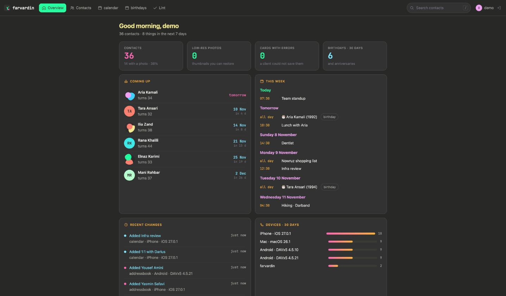
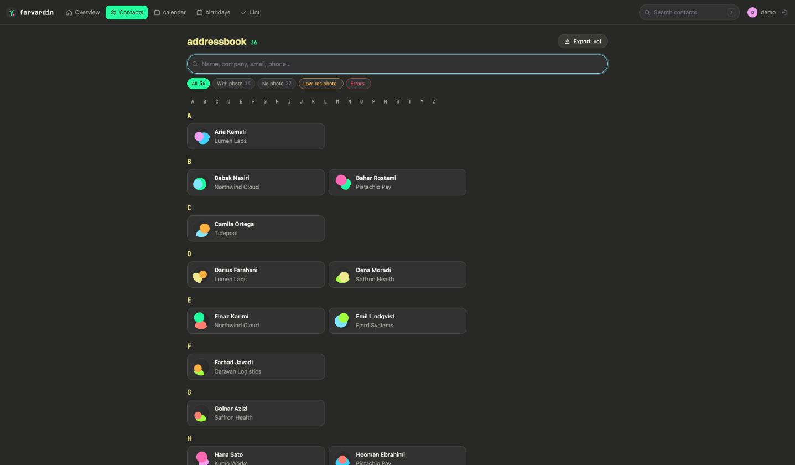
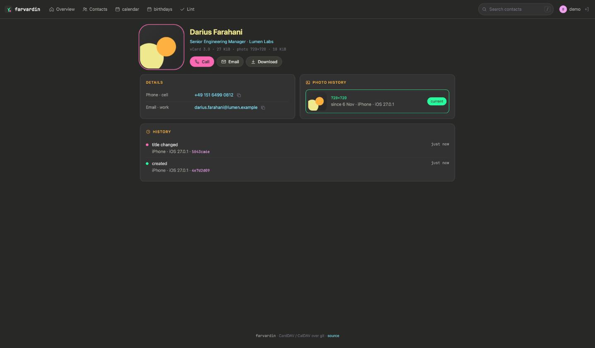
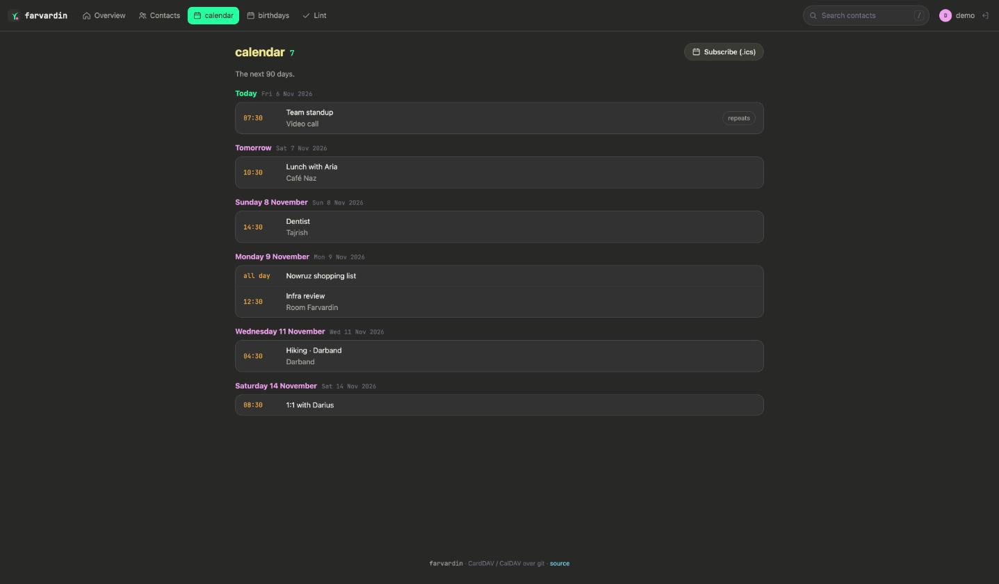
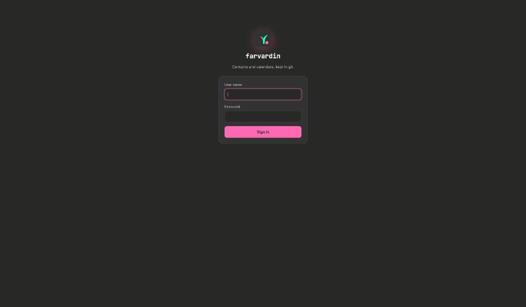
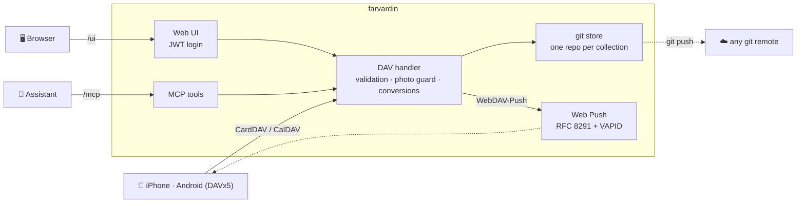

<div align="center">

<picture>
  <source media="(prefers-color-scheme: dark)" srcset="docs/assets/wordmark-dark.svg">
  
</picture>

**A CardDAV & CalDAV server that keeps your contacts and calendars in git.**<br>
Small enough for a Raspberry Pi, careful enough for the only copy of your address book.

[](https://github.com/1995parham-me/farvardin/actions/workflows/test.yaml)
[](https://github.com/1995parham-me/farvardin/actions/workflows/codeql.yml)
[](go.mod)
[](LICENSE)
[](#-small-devices)
[](#-mcp)

[Features](#-features) · [Screenshots](#-screenshots) · [Install](#-install) · [MCP](#-mcp) · [From Xandikos](#-moving-from-xandikos) · [Small devices](#-small-devices) · [How it works](#-how-it-works)



</div>

## ✨ Why farvardin

Your phones sync contacts and calendars over CardDAV and CalDAV, and the server is the copy they trust. farvardin is built for that responsibility:

- **Every change is a git commit.** Who changed what, from which device, and when, with every earlier version one click away. Back it up with `git push`.
- **It refuses to lose data.** Cards are validated before they are stored, a phone that sends a thumbnail of a photo cannot replace the full one, and two phones re-encoding the same picture no longer fight over it.
- **It speaks today's standards** — vCard 3.0 and 4.0, the 2024 additions of RFC 9554, JSContact, WebDAV sync and WebDAV-Push — and converts between them for each client.
- **It is a drop-in for [Xandikos](https://github.com/jelmer/xandikos).** Same store, same ETags, same sync tokens, same push subscriptions: point it at your Xandikos directory and the phones notice nothing.
- **It is small.** One static binary, no database, ~90 MiB of memory for a full first sync of a 1000-card address book on the small-board profile.

## 🌱 Features

<table>
<tr>
<td width="33%" valign="top">

### 📇 Contacts

- CardDAV ([RFC 6352](https://www.rfc-editor.org/rfc/rfc6352)) with `sync-collection`, multiget and `addressbook-query`
- vCard **3.0 ⇄ 4.0** per client, with [RFC 9554](https://www.rfc-editor.org/rfc/rfc9554) fields mapped to Apple's
- **JSContact** ([RFC 9553](https://www.rfc-editor.org/rfc/rfc9553)) on request
- **Photo guard**: thumbnails never replace a full photo; re-encodes keep the stored bytes; oversized photos are scaled once
- Byte-exact storage: lines nobody edited keep their bytes
- **Phone numbers**: with `phone_region` set to one country or a list (`["IR", "ES"]`), lint suggests the E.164 form of numbers without a country code and fixes them on request; search finds a number however it is written
- **Duplicates**: cards that share a number, an email or a name are grouped and can be merged into one, or marked as different contacts; a company and its people are never grouped by a shared number or email
- **Undelete**: every deleted contact can be restored, and any card can go back to an earlier version
- **Groups**: group cards (`X-ADDRESSBOOKSERVER-KIND:group`, what iOS writes and what DAVx5 turns into Android contact groups) and `CATEGORIES` are both read; the web UI filters by group and lists each group's members, and MCP creates and edits group cards

</td>
<td width="33%" valign="top">

### 📅 Calendars

- CalDAV ([RFC 4791](https://www.rfc-editor.org/rfc/rfc4791)) with time-range queries, recurring events included
- A live **birthdays calendar** generated from the address book
- Every calendar is also a **webcal feed** (`GET` returns one `.ics`)
- `MKCALENDAR`, colors, order and descriptions for Apple clients
- Push to the phones the moment anything changes
- **Your time zone** (`server.timezone`): floating times and all-day dates are read where you are, and Outlook zone names are understood

</td>
<td width="33%" valign="top">

### 🔁 Sync & safety

- **WebDAV-Push** ([draft](https://github.com/bitfireAT/webdav-push)) with RFC 8291 encryption and VAPID
- Validation, UID uniqueness and `If-Match` on every write
- Writes are fsynced before the branch moves: a power cut can't corrupt the store
- Collections can't be deleted over DAV — no phone can wipe itself empty

</td>
</tr>
<tr>
<td valign="top">

### 🖥️ Web UI

- Dashboard: coming birthdays, this week, recent changes by device
- Contacts: letter index, filters, search as you type (`/`)
- Per-contact **field-level history** and **photo history with Restore**
- **Tidy**: lint with *Add country codes everywhere*, duplicates with merge, deleted contacts with restore
- Restore any earlier version of a card; downloads in 3.0 / 4.0 / JSContact
- Its own login (JWT), in the [Naz](https://github.com/1995parham/naz.vim) palette, no external assets

</td>
<td valign="top">

### 🤖 MCP

- A [Model Context Protocol](https://modelcontextprotocol.io) endpoint with 28 tools
- Search, read, create, update and delete contacts and events
- History, photo restore, birthdays, lint
- Duplicates and merge, undelete, fix every phone number at once
- Every write is checked like a phone's and is a git commit naming the token

</td>
<td valign="top">

### 🍓 Runs anywhere

- One static binary, 16–20 MiB, no CGO
- Linux amd64 / arm64 / armv6 / armv7 / riscv64 / mipsle, macOS, FreeBSD
- `.deb` `.rpm` `.apk` Arch and OpenWrt `.ipk` packages, multi-arch images
- Prometheus metrics, bounded caches, streamed responses

</td>
</tr>
</table>

## 📸 Screenshots

<table>
<tr>
<td width="50%"><br><sub><b>Contacts</b> — letter index, filters for photos and errors, search as you type.</sub></td>
<td width="50%"><br><sub><b>A contact</b> — copy buttons, photo history with Restore, and what each device changed.</sub></td>
</tr>
<tr>
<td><br><sub><b>Agenda</b> — the next 90 days, grouped by day, subscribable as <code>.ics</code>.</sub></td>
<td><br><sub><b>Sign in</b> — its own login, so the UI does not need the DAV password prompt.</sub></td>
</tr>
</table>

<sub>The screenshots show a demo address book of invented people.</sub>

## 🚀 Install

```bash
go install github.com/1995parham-me/farvardin/cmd/farvardin@latest
farvardin serve --root ./data --listen 127.0.0.1:8000
```

Add an account in your phone with the server `http://<host>:8000/` (discovery finds the principal at `/user/`), and open `http://<host>:8000/ui/` in a browser.

<details>
<summary><b>📦 Packages and binaries</b></summary>

Every release publishes archives for Linux (amd64, arm64, armv6, armv7, riscv64, mipsle), macOS and FreeBSD, plus `.deb`, `.rpm`, `.apk`, Arch and OpenWrt `.ipk` packages with a hardened systemd unit (`DynamicUser`, `ProtectSystem=strict`, a memory ceiling):

```bash
sudo dpkg -i farvardin_*_linux_arm64.deb
sudo cp /etc/farvardin/config.example.toml /etc/farvardin/config.toml
sudo systemctl enable --now farvardin
```

</details>

<details>
<summary><b>🐳 Container</b></summary>

```bash
docker run -d --name farvardin -p 8000:8000 \
  -v farvardin-data:/var/lib/farvardin \
  ghcr.io/1995parham-me/farvardin:latest
```

Multi-arch: `linux/amd64`, `linux/arm64`, `linux/arm/v7`. Every config key can be set as `FARVARDIN_<SECTION>__<KEY>`, for example `FARVARDIN_UI__AUTH=jwt`.

</details>

<details>
<summary><b>⚙️ Configuration</b></summary>

All settings live in one TOML file; [`configs/config.example.toml`](configs/config.example.toml) documents each of them. The important ones:

| Section | What it controls |
| --- | --- |
| `[store]` | Where the git collections live (`root`, `principal`) |
| `[auth]` | DAV authentication: `none` (a proxy in front), `basic` (bcrypt users), `header` |
| `[ui]` | The web UI's own login: `proxy` or `jwt`, with `[ui.users]` |
| `[contacts]` | The photo policy: max size, guard, stabilize |
| `[calendars]` | The birthdays calendar and its reminder |
| `[push]` | WebDAV-Push and its VAPID key |
| `[mcp]` | The MCP endpoint and its tokens |
| `[performance]` | Memory and CPU limits for small boards |

</details>

## 🤖 MCP

farvardin serves your contacts and calendars to assistants over the [Model Context Protocol](https://modelcontextprotocol.io) at `/mcp` (Streamable HTTP, bearer token).

```bash
farvardin mcp-token claude          # prints a token and the line for [mcp.tokens]
claude mcp add --transport http farvardin https://dav.example.com/mcp \
  --header "Authorization: Bearer fv_…"
```

| Contacts | Calendars |
| --- | --- |
| `search_contacts` · `get_contact` · `create_contact` · `update_contact` · `delete_contact` | `list_calendars` · `list_events` · `get_event` |
| `contact_history` · `restore_contact_photo` · `upcoming_birthdays` · `lint_contacts` · `fix_contact_phones` · `fix_all_contact_phones` | `create_event` · `update_event` · `delete_event` |
| `find_duplicate_contacts` · `merge_contacts` · `mark_not_duplicates` · `list_deleted_contacts` · `restore_contact` | |
| `list_groups` · `create_group` · `add_to_group` · `remove_from_group` · `rename_group` · `delete_group` | |

Writes take the etag that was read, so an assistant never overwrites a newer edit from a phone. They go through the same validation as a phone's write, are pushed to the phones at once, and are git commits with `Requester: farvardin MCP (<token>)`, so every change can be seen and undone. The config keeps only each token's SHA-256.

## 🔄 Moving from Xandikos

1. Stop Xandikos.
2. Point `store.root` at the Xandikos root (the directory with `user/`) and keep `principal = "user"`. For push, set `[push] state_dir` to Xandikos's `--state-dir`.
3. Start farvardin on the same address.

That is all. Both servers use the git blob id as the ETag, the tree id as the sync token, Python-style escaping for hrefs, and the same push files, so the phones keep their sync state and their push subscriptions. Moving back works the same way. This was verified against a live Xandikos with a 988-card address book before the switch.

## 🍓 Small devices

farvardin is built for boards like a Raspberry Pi, and measured on a real 988-card, 32 MB address book during a full first sync:

| Profile | Peak memory | Notes |
| --- | --- | --- |
| Defaults (Pi 4) | **~167 MiB** | was 530 MiB before the small-device pass |
| Small board (`memory_limit_mb = 64`, small caches) | **~87 MiB** | fits a 256 MB board |

How it stays small:

- cached cards are *slim*: photo bytes are dropped, their size and identity kept;
- go-git's object cache is bounded (8 MiB per collection instead of 96 MiB);
- reports are streamed one response at a time;
- images are decoded two at a time and never above `max_image_pixels`;
- push messages are coalesced per collection; bcrypt runs one at a time;
- history and avatars are indexed once in the background, so pages render in milliseconds.

## 🧭 How it works



```text
<root>/<principal>/contacts/<address book>/   a git repository (one commit per change)
    .xandikos                                 metadata: name, color, …
    <uid>.vcf
<root>/<principal>/calendars/<calendar>/
    <uid>.ics
```

Each write is a commit (`Added`, `Modified` or `Deleted <file>`, with the client's User-Agent as `Requester:`), moved with a compare-and-swap after the new objects are fsynced. The checked-out files and the index are kept in step, so `git status` stays clean.

## 🛠️ Command line

```text
farvardin serve            run the server (--listen and --root override the config)
farvardin lint DIR|FILE    check vCards; exits 1 when a card has errors (-w for warnings, -r IR,ES to read national phone numbers)
farvardin convert FILE     convert vCards: --to 3.0 | 4.0 | jscontact
farvardin hash-password    bcrypt hash for [auth.users] / [ui.users]
farvardin mcp-token NAME   bearer token for [mcp.tokens]
```

## 🧪 Development

```bash
just test     # go test -race ./...
just lint     # golangci-lint, a strict configuration
just dev      # build and serve ./data
```

CI runs the linter, the tests with `-race` on x86 and on native ARM, the whole suite as a 32-bit build, cross-builds for every target, and a GoReleaser dry run. See [docs/ROADMAP.md](docs/ROADMAP.md) for what comes next.

## 🌸 The name

[Xandikos](https://github.com/jelmer/xandikos) is named after Xandikos, a spring month of the ancient Macedonian calendar. **Farvardin** (فروردین) is its Persian counterpart: the first month of the Iranian year, the month of Nowruz, when everything starts growing again. The logo is that: a new sprout, in the colors of [Naz](https://github.com/1995parham/naz.vim).

## 📄 License

[Apache-2.0](LICENSE).
